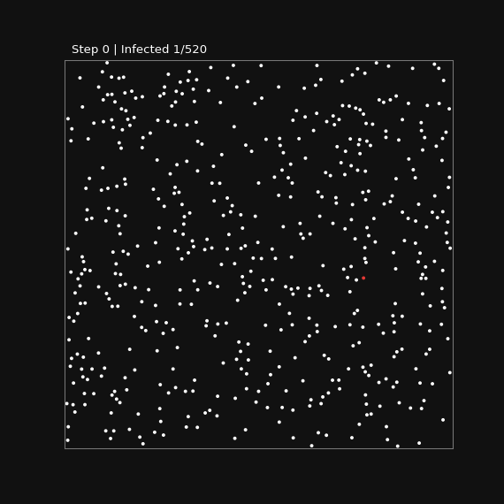

# Infection Spread

2次元空間で球が移動し、接触によって感染が広がるシミュレーションです。最初は1個が感染しています。

## Animation

**初回のGIFアップロード前は画像が表示されません。** ColabでGIFを生成し、GitHubアップロードを有効にして実行すると、この画像が自動更新されます。

## Colabでの使い方

1. 上のColabリンクを開き、最初のコードセルを実行して関数を読み込みます。
2. 最後のセルを実行し、球の数・半径・速度・ステップ数・時間刻み・方向の揺らぎをスライダーで調整します。
3. 「シミュレーションを実行してGIFを生成」を押すと、計算とGIF生成の進捗バー、感染数、GIFが表示されます。
4. READMEにも反映したい場合は、実行前に「生成後にGitHubへアップロード」にチェックを入れます。Colab Secretsの `GITHUB_TOKEN` に対象リポジトリの **Contents: Read and write** 権限が必要です。

## 衝突と描画

- 球の**物理半径と描画半径を一致**させています。見た目だけ大きい球にはなりません。
- 1ステップの移動を小さな内部サブステップに分割し、接触の見逃しを減らします（厳密な連続衝突判定ではありません）。
- 小さい半径や多い球数は計算時間が増えます。内部更新回数の目安は操作パネルで確認できます。

## Outputs

| File | Content |
| --- | --- |
| `outputs/infection.gif` | アニメーション（READMEに自動表示） |
| `outputs/infection_curve.png` | 感染数の推移 |
| `outputs/infection_counts.csv` | ステップごとの感染数 |
| `outputs/settings.json` | 実行パラメータ |

MP4は生成しません。
